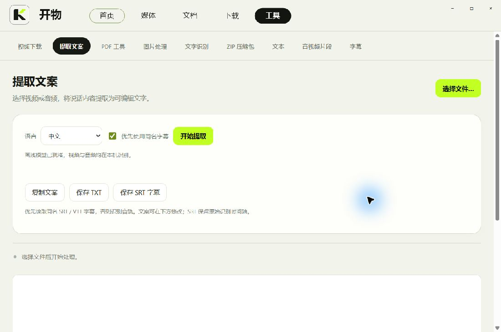

# 开物 Kaiwu


一个 Windows 桌面文件工具，把视频、音频、图片、文档和常用处理功能放进同一个窗口。

[下载 Windows 便携版](https://github.com/dls0412/kaiwu/releases/latest) · [问题反馈](https://github.com/dls0412/kaiwu/issues)


## 下载与使用

1. 在 Releases 下载 `kaiwu-v0.4.4-windows-x64.zip`。
2. 解压整个文件夹，双击 `开物.exe`。保留同目录的 DLL、app、helpers、licenses 和 ui 文件夹。
3. 支持打开或拖入文件。也可在 Windows 的“打开方式”中选择开物。

支持 Windows 10 / 11 x64，需要 .NET Framework 4.8 和 Microsoft Edge WebView2 Runtime。媒体与看图使用原生窗口；文档和文件工具按需启动 WebView2。文档内核已随包提供，运行无需安装 WPS、Microsoft Office 或 LibreOffice。包内不包含独立 Chromium、Node 或 Python。

## 功能

| 场景 | 当前功能 |
| --- | --- |
| 视频与音频 | 常见格式播放、拖动定位、音量、倍速、字幕、全屏、播放列表 |
| 保存画面 | 原分辨率 PNG 截图；最长 30 秒、约 10 FPS、宽度不超过 640 像素的 GIF |
| 看图 | 按图片比例适配窗口、EXIF 方向、缩放、旋转、同文件夹切换、GIF 动画 |
| 文档 | 文字、表格、演示文稿的查看、编辑、保存、常用格式转换及 PDF 导出、打印预览 |
| PDF | 合并、提取页、逐页拆分、转图片、图片合并成 PDF |
| 图片与文字 | 裁剪、尺寸调整、压缩、格式转换；Windows 本机 OCR |
| 文件工具 | ZIP 浏览、打包与解压；TXT/Markdown/JSON 编辑；SRT/VTT 转换 |
| 音视频处理 | 指定起止时间导出视频，或提取 MP3/M4A/WAV |
| 视频下载 | 粘贴抖音、小红书的公开分享链接，解析后保存，显示实际下载进度 |
| 提取文案 | 本机识别视频或音频，编辑、复制、保存 TXT，导出带时间轴的 SRT |

文档常用转换范围：文字 DOCX/DOC/ODT/RTF/TXT/PDF；表格 XLSX/XLS/ODS/CSV/TSV/PDF；演示 PPTX/PPT/ODP/PDF。

提取文案可优先读取同名 SRT/VTT；取消勾选后识别音轨。首次语音识别需下载约 190 MB 的量化多语言模型，下载完成后可离线使用。视频与音频不上传到识别服务，识别结果可继续校对。



## 快捷键

| 按键 | 操作 |
| --- | --- |
| Ctrl+O | 打开文件 |
| Ctrl+H / Ctrl+D / Ctrl+T | 首页 / 文档 / 文件工具 |
| 空格 | 播放 / 暂停 |
| 左右方向键 | 视频快退 / 快进；图片上一张 / 下一张 |
| F / F11 / 双击 | 播放全屏；Esc 退出 |
| S / G | 截图 / 开始或停止 GIF 录制 |
| 图片模式 0 / 1 / R | 适应 / 实际大小 / 旋转 |
| Ctrl+Shift+E | 文档格式转换 |

## 从源码构建

在 Windows PowerShell 中执行：

```powershell
git clone https://github.com/dls0412/kaiwu.git
cd kaiwu
.\tools\setup-dependencies.ps1
.\build.ps1 -OutputDirectory dist-v0.4
.\dist-v0.4\开物.exe
```

`setup-dependencies.ps1` 下载版本固定的依赖包并校验 SHA256。源码仓库保留界面与逻辑，mpv、文档 WASM、WebView2 SDK、Lux 和 whisper.cpp 等运行依赖通过 Release 分发，模型按需下载。

使用系统 .NET Framework x64 C# 编译器；构建过程无需 npm、Node 或 Python。`-TestBuild` 可隔离文档与最近文件缓存，正式版不开启 WebView2 调试端口。

目录：`src` 为 C# 主程序，`documents/app` 为文档与工具前端，`ui` 为图标与界面资源，`tools` 为依赖准备和图标打包工具，`docs` 为说明与真实界面截图。

## 当前边界

- 未实现 PDF 转 Word；EPUB/HTML 文档导出未开放。
- 复杂宏、特殊字体、动画和复杂 Office 版式的完整兼容性尚未验收。
- ZIP 工具不支持 RAR/7Z；TIFF 查看只显示第一页。
- 小红书的部分公开链接当前会跳转至平台限制或登录页，解析可能失败；抖音也受平台访问限制、非公开视频和失效链接影响。部分分段或需要额外合并的流尚不支持。
- DRM 视频、损坏文件及厂商私有格式不保证可播放；4K/HDR、全部 GPU 的硬解性能尚未单独验收。
- 当前为早期版本，持续按实际需求改进。

## 开源与第三方

项目代码按 [GPL-3.0-or-later](LICENSE.txt) 发布。第三方组件保留各自许可与版权声明，详见 [THIRD-PARTY.md](THIRD-PARTY.md) 和 `documents/licenses`。开物通过成熟的开源内核实现媒体解码、文档编辑和语音识别。
